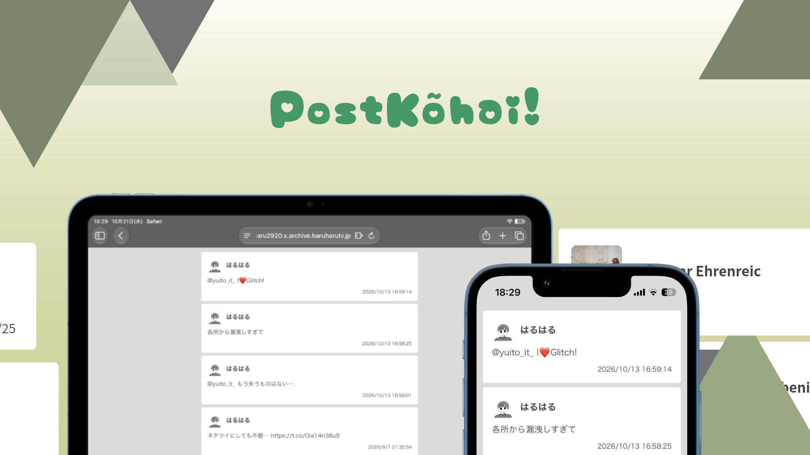

# X Archive Website Exchange Tool
### PostKõhai!


## Abstract
Whether you delete your X account or make it private, you may still want to keep your public conversation data online. 
This tool analyzes your archived X data (`tweets.js`), converts it into a website with a timeline UI, and immediately deploys it to the internet!

## How it works
1. **Data Loading:** Loads the formatted data (`fx-yyyy-mm-dd.json`, `fx-user.json`) from the repository.
2. **Conversion & Optimization:** Extracts the data, converts it into HTML, and compresses images into the AVIF format for high efficiency.
3. **Deployment:** Finally, deploys your website to Cloudflare's global network.

## Important Notice
> [!WARNING]
> **Please inspect your files carefully before pushing.**
> Never push the entire X archive ZIP file or folder to GitHub, as these files may contain sensitive personal information.

## Features
It is generally a formatting tool that utilizes GitHub Actions.
However, this project does not use GitHub Actions.
Instead, it utilizes Cloudflare Pages build commands.
Therefore, you can build a professional, robust, and rich user interface with just a single command.

## Getting Started
1. Download the X archive data from https://x.com/settings/download_your_data.
2. Extract zip and find a “tweets.js”.
3. upload to “tweets.js” to “tools/tweets-js_exchanger.html” and download “fx-yyyy-mm-dd.json”.
4. make a “fx-user.json”. I suggest read a following Specification.
5. Repository connect to Cloudflare Pages and build command type following and set the build output to “dist” and finally push save.

```bash
npm i --no-save --no-audit --no-fund sharp html-minifier-terser && node -e 'const fs=require("fs"),sharp=require("sharp"),{minify}=require("html-minifier-terser");(async()=>{const u=JSON.parse(fs.readFileSync("fx-user.json","utf8")).user;const f=fs.readdirSync(".").filter(n=>/^fx-\d{4}-\d{2}-\d{2}\.json$/.test(n)).sort().pop();const p=JSON.parse(fs.readFileSync(f,"utf8")).sort((a,b)=>b.submitted_id-a.submitted_id);fs.mkdirSync("dist",{recursive:true});await sharp(u.path.icon).resize(96,96,{fit:"cover"}).avif({quality:20,effort:9}).toFile("dist/fx-icon.avif");const e=s=>String(s).replace(/&/g,"&amp;").replace(/</g,"&lt;").replace(/>/g,"&gt;").replace(/\n/g,"<br>");const d=s=>new Date(s).toLocaleString("ja-JP",{timeZone:"Asia/Tokyo"});const h=`<!DOCTYPE html><html lang="ja"><head><meta charset="utf-8"><meta name="viewport" content="width=device-width, initial-scale=1.0"><title>${e(u.text.name)}のアーカイブ | X | 歴史的資料</title><link rel="stylesheet" href="sttx.css"></head><body><div class="message_container">${p.map(m=>`<div class="message_box"><div class="message_box_header"><div class="message_box_header_username">${e(u.text.name)}</div></div><div class="message_box_content">${e(m.send_message)}</div><div class="message_box_date">${d(m.send_date)}</div></div>`).join("")}</div></body></html>`;fs.writeFileSync("dist/index.html",await minify(h,{collapseWhitespace:true,removeComments:true,removeAttributeQuotes:true,minifyCSS:true}));if(fs.existsSync("sttx.css"))fs.copyFileSync("sttx.css","dist/sttx.css")})()'
```

That’s all! Enjoy your X Archive on website!

## Specification

### `fx-user.json` Example

```json
{
  "user": {
    "path": {
      "icon": "fx-icon.jpg"
    },
    "text": {
      "name": "はるはる"
    }
  }
}
```
⁠path⁠ field: Specifies the file path for the user icon.
text⁠ field: Specifies the display name for the user.
